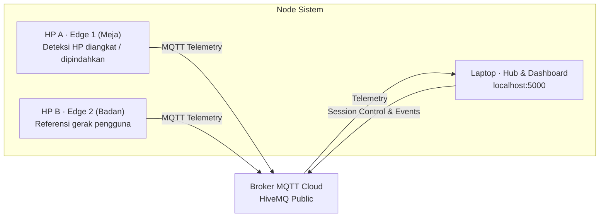

# FocusGuard IoT

Proyek IoT pemantau kontinuitas belajar: **2 HP Android sebagai edge**, **sensor accelerometer + gyroscope**, **2 tahap pengolahan data**, **MQTT Cloud HiveMQ**, dan **dashboard web di laptop**. Data bersumber dari sensor fisik langsung melalui Termux.

## Cara Kerja



| HP A (Meja) | HP B (Pengguna) | Keputusan Sistem | Keterangan |
|:---|:---|:---|:---|
| Diam | Diam | FOKUS | Sesi belajar berlangsung normal |
| Bergerak | Diam | INTERUPSI | HP diangkat atau disentuh saat pengguna tetap di tempat |
| Bergerak | Bergerak | COMMON_MOTION | Pengguna meninggalkan area belajar bersama HP |
| Diam | Bergerak | FOKUS | Pengguna bergerak di sekitar meja tanpa mengganggu HP |

## Ketentuan Teknis Proyek

| Ketentuan | Implementasi FocusGuard |
|:---|:---|
| 2 Edge Devices | HP A (meja belajar) dan HP B (badan/saku pengguna) |
| 2 Sensor per Device | Accelerometer dan Gyroscope |
| 2 Data Processing | 1. RMS deviasi magnitudo dengan Adaptive EMA baseline<br/>2. Ekstraksi deviasi standar dan windowing sinyal rotasi |
| Algoritma | Rule-based sensor fusion dengan debouncing (1.5 detik) dan interval merging (4 detik) |
| Protokol Cloud | MQTT melalui broker publik HiveMQ (port 1883) |
| Dashboard | Antarmuka web Flask + Chart.js di laptop (port 5000) |

## 1. Laptop — Jalankan Server dan Dashboard

Kebutuhan: **Python 3.10+** dan koneksi internet.

### Instalasi Dependensi

```bash
git clone https://github.com/Bintodd/IOT_FocusGuard.git
cd focusguard
pip install -r requirements.txt
```

### Konfigurasi Identitas Proyek

Buka berkas `config/config.py` dan pastikan `PROJECT_ID` unik untuk kelompok Anda:

```python
PROJECT_ID = "focusguard_group"
```

*Catatan: Nilai `PROJECT_ID` harus sama persis antara laptop dan kedua script HP.*

### Jalankan Server

```bash
python main.py
```

Buka peramban di laptop dan akses **http://localhost:5000**.

## 2. Menyiapkan HP A dan HP B via Termux

Gunakan dua perangkat Android fisik dengan aplikasi **Termux** dan **Termux:API** (unduh via F-Droid).

### Persiapan Lingkungan Termux (di kedua HP)

Jalankan perintah berikut di terminal Termux:

```bash
pkg update -y
pkg install -y python termux-api git
pip install paho-mqtt
```

Pastikan sensor terbaca oleh Termux:API:

```bash
termux-sensor -l
```

Salin direktori proyek ke kedua HP, atau salin berkas `config/config.py` beserta script mobile masing-masing.

### Menjalankan Node Edge

**HP A (Study Phone diletakkan di meja):**
```bash
python mobile/hp_a_study_phone.py
```
*Script membaca sensor `lsm6dsoq_acc` dan `lsm6dsoq_gyro` dapat diganti menyesuaikan nama sensor untuk HP A*

**HP B (Activity Reference disimpan di saku pengguna):**
```bash
python mobile/hp_b_activity_ref.py
```
*Script mendeteksi sensor gerak otomatis dan mengirim status gerak pengguna.*

## 3. Menjalankan dan Menguji Sesi

1. Letakkan **HP A** di meja belajar dalam posisi stabil.
2. Kantongi **HP B** atau pasang di badan pengguna.
3. Buka dashboard di laptop (**http://localhost:5000**), lalu klik **Mulai Sesi**.
4. **Skenario Normal:** Duduk tenang dan membaca. Dashboard mencatat status **Fokus**.
5. **Skenario Interupsi Meja:** Angkat HP A tanpa bangkit dari kursi. Dashboard berganti ke status **Interupsi**.
6. **Skenario Meninggalkan Meja:** Bawa HP A dan HP B berjalan bersamaan. Dashboard mencatat kondisi **Common Motion**.
7. Akhiri sesi dengan tombol **Selesai**. Metrik akhir (Durasi Sesi, Total Durasi Interupsi, dan Rasio Kontinuitas) akan dihitung otomatis dan tersimpan ke riwayat.

## Struktur Berkas Proyek

- `main.py`: Titik masuk server pengolah data dan perute dashboard laptop.
- `core/processor.py`: Pengolahan sinyal accelerometer (RMS magnitudo deviasi) dan gyroscope (deviasi standar).
- `core/session_manager.py`: Mesin status sesi, fusi sensor, debouncing, dan kalkulasi kontinuitas belajar.
- `core/mqtt_client.py`: Klien MQTT untuk penerima telemetri edge dan penyalur event.
- `mobile/hp_a_study_phone.py`: Node Edge 1 untuk membaca dan mengirim data HP meja.
- `mobile/hp_b_activity_ref.py`: Node Edge 2 untuk membaca aktivitas fisik pengguna.
- `mobile/mock_devices.py`: Simulator edge untuk pengujian sintesis tanpa HP fisik.
- `web/server.py`: Layanan Flask REST API dan penyedia antarmuka visual.
- `web/static/js/dashboard.js`: Pengendali visual dashboard dan grafik Chart.js real-time.

## Panduan Tambahan

- Panduan instalasi dan debugging sensor Termux: [`PANDUAN_PENGGUNAAN.md`](PANDUAN_PENGGUNAAN.md)

## Batasan Sistem

- FocusGuard mengukur indikasi interupsi fisik (gerakan perangkat), bukan konsentrasi kognitif atau aktivitas gelombang otak pengguna.
- Broker MQTT publik tidak memakai autentikasi berbayar. Gunakan `PROJECT_ID` unik dan jangan mentransmisikan data sensitif.
